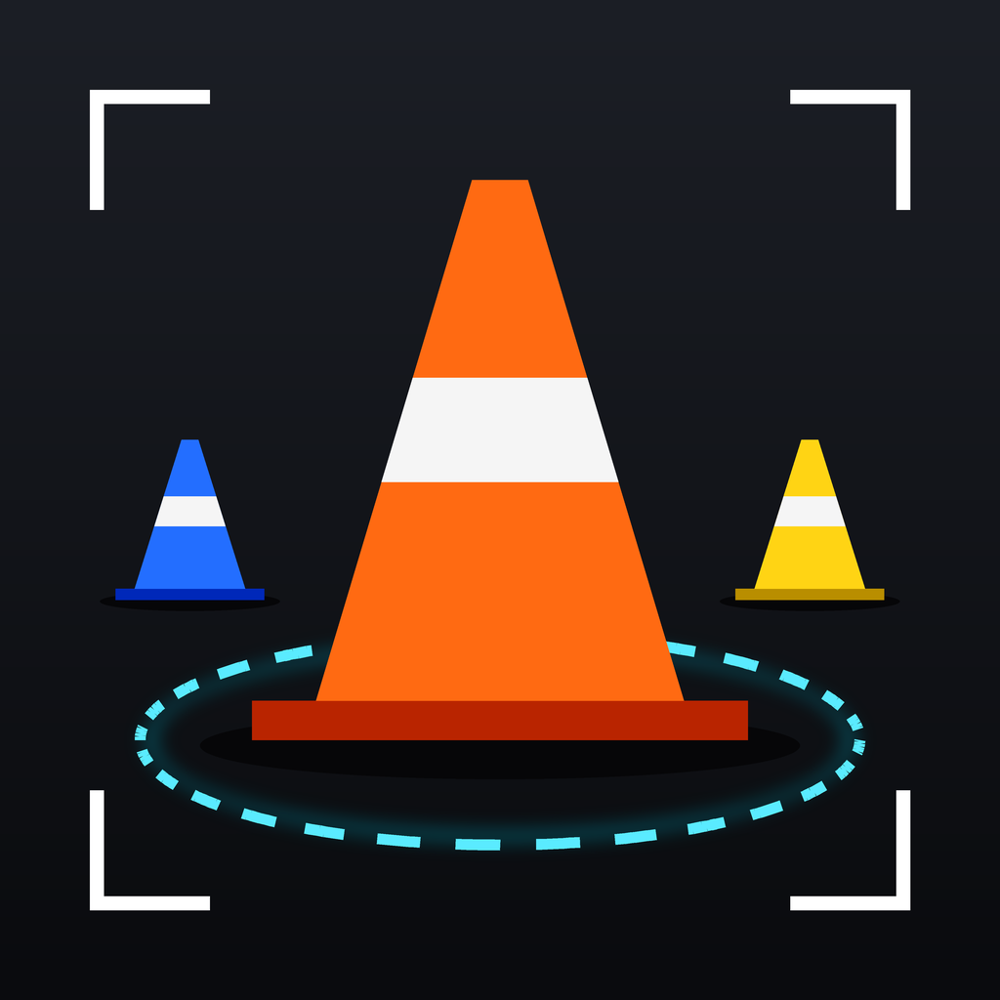
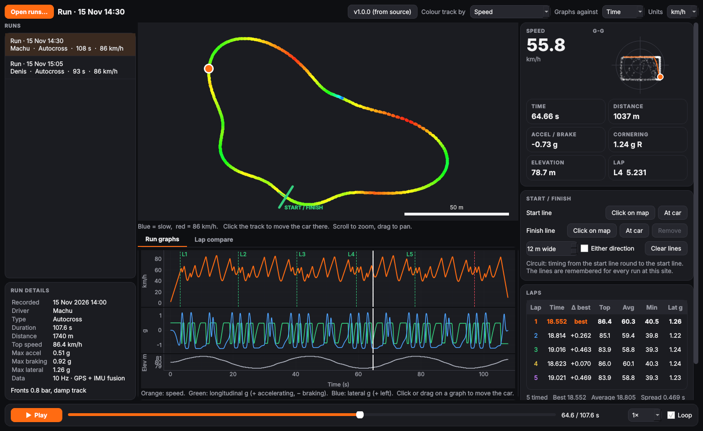
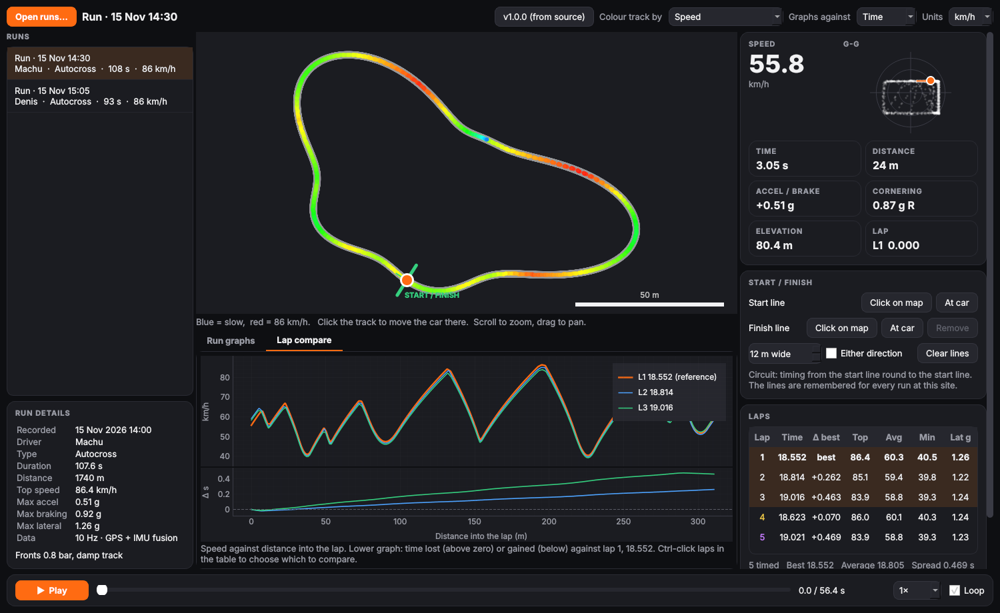

<div align="center">



# OBRA Essentials

**The Oxford Brookes Racing Autonomous toolkit: lay out cones, log runs, view CAD, tune the motor controller, and analyse it all on a PC.**

<a href="https://github.com/NB6RULES/OBRA-Essentials/releases/download/analyzer-latest/OBRA-Run-Analyzer.exe"></a>
&nbsp;
<a href="https://github.com/NB6RULES/OBRA-Essentials/releases/latest/download/OBRA-Essentials.ipa"></a>

<a href="https://raw.githubusercontent.com/NB6RULES/OBRA-Essentials/main/source.json"></a>
&nbsp;
<a href="https://github.com/NB6RULES/OBRA-Essentials/releases/download/analyzer-latest/demo-runs.zip"></a>

<br>


[](https://github.com/NB6RULES/OBRA-Essentials/actions/workflows/build.yml)
[](https://github.com/NB6RULES/OBRA-Essentials/actions/workflows/desktop.yml)


</div>

---

## What's inside

| | Tool | What it does |
|:-:|---|---|
| 🟠 | **Cones** (iPhone) | AR + LiDAR guide for laying out FS-AI skidpad, acceleration and autocross tracks, cone by cone |
| 🔵 | **GPS** (iPhone) | 10 Hz GPS + IMU speed logger: heatmap track, graphs, driver / run type / notes, Excel / CSV / GPX, several runs in one zip |
| 🟣 | **3D** (iPhone) | Offline viewer for STEP, IGES, STL, DXF, OBJ, 3MF, glTF, Blender and more |
| 🟢 | **FarLink** (iPhone) | Dashboard, tuning and registers for FarDriver motor controllers over Bluetooth |
| 🪟 | **Run Analyzer** (Windows) | Plays runs back on a satellite map, times laps between start / finish lines you place, overlays laps, and shows car CAN logs (MF4 + DBC) on the same timeline |

<div align="center">



*OBRA Run Analyzer on Windows: track coloured by speed, live readouts, start / finish line and lap table.*



*Lap compare: speed against distance for the chosen laps, and time lost or gained against the fastest.*

</div>

## 🪟 Get the Windows Run Analyzer

1. Press the blue **Download** button above. It always gives the newest build of `OBRA-Run-Analyzer.exe`, a single file with no installer.
2. Run it. Windows may say "Windows protected your PC" because the file isn't signed: choose *More info*, then *Run anyway*.
3. Drop in a zip saved from the app's GPS tab (*Select* → *Save as zip*), or the demo runs above.

The analyzer checks for a newer build every time it starts and offers to update itself. Details: [desktop/README.md](desktop/README.md).

## 📱 Get the iPhone app

Built for the iPhone 17 Pro Max; works on any LiDAR iPhone on iOS 18 or later.

### Install with SideStore

Add this source in SideStore (**Sources → +**):

```
https://raw.githubusercontent.com/NB6RULES/OBRA-Essentials/main/source.json
```

Every push to `main` builds a new unsigned IPA on GitHub Actions, publishes it as a release and updates `source.json`, so SideStore shows the update.

## 🟠 Cones tab: how placing works

1. **Pick a layout.** Skidpad and acceleration are generated from FS dimensions (all editable). Autocross / trackdrive come from a CSV.
2. **Mark two references.** Tape A and B on the ground (e.g. both skidpad circle centres, or the acceleration start and finish line centres). In the app, aim the crosshair at A and tap *Set A*, then the same for B. The app checks the A–B distance against the plan.
3. **Follow the ghost cones.** The panel shows the next cone, an arrow, the distance, and how far the crosshair spot is from the exact position. The crosshair turns green and the phone buzzes inside your tolerance.
4. **Mark the cone.** Put the real cone in the ghost, look down at it, put the crosshair on its tip and tap *Mark placed*. Because the tip sits straight above the base centre, the app gets the base position without seeing under the cone.
5. **Chain mode** (on by default) sets each new cone out from the real cones nearest to it, so ARKit drift doesn't build up down a long straight.

The top-left chips show tracking state, LiDAR mapping, phone GPS accuracy, and the fit RMS across all marked cones. Cones more than 2× tolerance (min 5 cm) from the plan turn red. Tap any cone on the mini-map to (re)do it.

Sessions save the progress, the ARKit world map and a GPS site tag. On a later test day, open the session and walk around: if the saved map is recognised, it carries on; otherwise tap A and B again and it restores the cones you already placed.

## 🔵 GPS tab (speed logger)

Records the car's speed with timestamps and coordinates, and keeps running with the screen locked.

- **Sensors:** GPS (about 1 Hz) is fused with the IMU (100 Hz) into a **10 Hz** trace, and the barometer gives elevation. Mount the phone firmly in any orientation. The app learns which way is forward from the first launch, braking or corners. When a run stops, the whole run is fused again with the final calibration, so the launch is captured too. If the phone moves or the IMU isn't used, the app falls back to GPS only.
- **Run view:** satellite map with a heatmap path (blue = slow, red = top speed), top / average / moving-average speed, distance, duration, max acceleration, braking and lateral g, 0–100 km/h, 75 m from launch with trap speed, elevation range and climb/descent. Graphs show speed (by time or distance), acceleration (longitudinal and lateral) and elevation. Drag on a graph to see that moment on the map.
- **Skip stops:** hides stationary periods so the graphs close up, with dashed markers where time was cut. **Advanced** sets the speed below which data is skipped, the minimum stop length, and the time kept either side.
- **Excel export (.xlsx):** a Summary sheet with stats plus track and graph images, a Charts sheet with native editable charts (speed, acceleration, speed vs distance, elevation, and the track map coloured by speed band), every sample on the Data sheet, raw GPS fixes, and the series behind the charts. CSV and GPX exports are also available.
- **Driver, run type and notes:** tap the card under the top speed on a run (or touch and hold a run in the list) to set its name, driver, run type (Acceleration, Skidpad, Autocross… or your own) and free notes. They show in the run list and go into the Excel Summary sheet, the GPX description and the file name.
- **Save several runs as one zip:** tap **Select** above the run list, tick the runs, then **Save as zip** and choose Excel, CSV, GPX or all three. The zip also holds `Runs.csv`, one row per run with its driver, type, notes and headline numbers.
- **Import runs:** the gear menu's **Import runs (.zip)** reads a zip saved from the app (or a single run CSV / backup JSON), restoring names, drivers, types and notes and skipping runs already on the phone. Opening a zip from Files with *Open in OBRA Essentials* does the same. A zip needs CSV or **Full backup** inside; the backup keeps the raw GPS fixes and barometer data too, CSV keeps the processed samples.
- Runs autosave every 30 s. A run cut off by the app closing is recovered the next time the Speed tab opens.

CI runs `Tests/Harness/main.swift`, which simulates laps with noisy GPS, IMU and barometer and an arbitrary phone mount, before every build. Its outputs, including a sample Excel export, are attached to the `ci-test` pre-release.

## 🟢 FarLink tab (FarDriver motor controllers)

FarLink, previously a separate app ([NB6RULES/Farlink](https://github.com/NB6RULES/Farlink)), is built in as the fourth tab. The connection bar at the top opens the scanner (or a demo controller). Below it, **Dash** shows live speed, power, battery, currents and temperatures; **Tune** edits the catalogued parameters; **Registers** reads and writes raw registers and shows the traffic log; **Settings** covers the handshake, units, wheel size and write safety. Bluetooth permission is only asked for the first time this tab is opened. Settings from the standalone FarLink app are not carried over.

The protocol code is checked in CI by `Tests/FarLinkHarness/main.swift`. It is built on community reverse-engineering of the FarDriver protocol (jackhumbert/fardriver-controllers) and is not affiliated with Nanjing FarDriver.

## 🟣 3D tab (CAD and 3D file viewer)

Opens 3D files offline, from the in-app picker or by sharing a file to OBRA Essentials from the Files app.

- **CAD:** STEP, IGES, BREP, FreeCAD (.fcstd), Rhino (.3dm), read with the OpenCascade kernel compiled to WebAssembly.
- **Drawings:** ASCII DXF (lines, polylines with bulges, arcs, circles, ellipses, splines, blocks, 3D faces and polyface meshes). Text and hatches aren't drawn.
- **Mesh:** STL, OBJ, PLY, OFF, 3MF, AMF, glTF / GLB, FBX, DAE, 3DS, VRML.
- **Blender:** .blend files (`blend.js`, an own reader driven by the file's SDNA; verified against Blender 4.2, 4.5 and 5.2, including Zstandard-compressed files). Mesh objects are shown in world space with viewport material colours. Modifiers aren't applied, and curves, text and instanced collections aren't shown.
- **Viewer:** orbit, pinch-zoom and pan; Iso / Front / Back / Left / Right / Top / Bottom views; feature edges; perspective or orthographic; Y-up or Z-up; overall size, triangle and part counts.
- **Closed formats** (SolidWorks .sldprt, CATIA .CATPart, NX / Creo .prt, Fusion .f3d, Inventor .ipt, DWG, Parasolid, JT) can't be read by anything but their own software. The app says so, shows the export steps for a STEP or DXF, and shows the preview picture embedded in the file when there is one.

The viewer is the [Online 3D Viewer](https://github.com/kovacsv/Online3DViewer) engine in a web view, with `occt-import-js`, `rhino3dm` and `draco3d` bundled under `OBRAEssentials/Resources/Viewer/libs` (licences in `LICENSES.txt`).

## CSV format

One cone per row, comma / semicolon / tab separated, metres, `x` forward and `y` left:

```
colour,x,y
refA,0,0
refB,30,0
blue,5,1.5
yellow,5,-1.5
big_orange,0.5,1.5
```

`colour,x,y`, `x,y,colour`, `id,colour,x,y` and FSDS-style `tag,x,y,...` rows are all accepted. If `refA` / `refB` are missing, A is the first cone and B is the farthest cone from it. See `examples/sample_autocross.csv`.

*Export CSV* in the placement screen writes the plan and measured position of every cone, with the error in cm.

## Accuracy notes

- LiDAR measures out to about 5 m. Longer distances rely on ARKit tracking, which drifts. Chain mode, the A–B baseline and the fit RMS are there to keep that in check.
- Plain, smooth concrete tracks worse than textured tarmac.
- Phone GPS (±3–5 m) only tags the site. It can't place cones.
- Check every dimension against the current FS / FS-AI rules and handbook before a real test.

## Building

The Xcode project is generated with [XcodeGen](https://github.com/yonaskolb/XcodeGen):

```
brew install xcodegen
xcodegen generate
open OBRAEssentials.xcodeproj
```

CI: `.github/workflows/build.yml` (macOS runner, unsigned build, release + `source.json` update via `scripts/update_source.py`).
